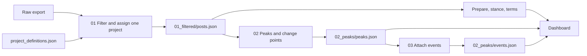

# Riding the Sentiment

Prototype for the Heilbronn Future City hackathon. The question is how people talk about the planned urban cable car, how that compares with Bonn, Paris Câble C1, and the IPAI campus, and which moments move the debate.

The challenge brief sits next to this repository: `../readme Seilbahn_Challenge.docx`. The raw export sits there too, because it is too large for git: `../FSI_Heilbronn_Medienbeiträge (1).json`.

## Layout

```
dashboard.py                         page only. start this.
analysis/                            what the page computes
  config.py                          cities, channels, circle source, trend
  prepare.py                         text, city, channel
  stance.py                          vendor tone and text stance
  terms.py                           word-cloud terms
  summary.py                         timeline, circles, trend, peak markers
pipeline/                            batch steps, in order
  01_filter_posts.py                 date, near-duplicate, one project
  project_definitions.json           topic terms and context terms
  02_detect_peaks.py                 peaks and change points
  03_attach_events.py                news around each peak
data/
  01_filtered/posts.json             kept posts. one project each
  01_filtered/audit.json             filter log
  02_peaks/peaks.json                peaks and change points
  02_peaks/events.json               crawler output. not produced yet
  rejected/                          dropped posts, by reason
  exports/                           inspection copies from the explore notebook
notebooks/
  walk_through_dashboard.ipynb       same numbers as the page
  explore_language_and_channels.ipynb
```

`data/exports/` is not an input. The page never reads it. A fresh run of the explore notebook overwrites it.

## Run

```bash
pip install -r requirements.txt
python pipeline/01_filter_posts.py    # only if posts.json is missing
python pipeline/02_detect_peaks.py
python pipeline/03_attach_events.py   # needs network; writes events.json
python dashboard.py                   # http://127.0.0.1:8765
```

The page reads `data/01_filtered/posts.json` on startup. Peak lines come from `data/02_peaks/events.json` when that file exists, otherwise from `peaks.json`. Restart the page after a new pipeline run.

## Data flow



One kept post has exactly one project. The page then cuts that table by city, channel, and date. Peak markers are counted on every kept post of a project. They do not follow the News / Social switch. A marker can sit on a quiet day in one channel because the spike was in the other.

## Methods in use

| Step | Method | Where |
| --- | --- | --- |
| Keep a post | Valid ISO date, then near-duplicate, then project | `pipeline/01_filter_posts.py` |
| Near-duplicate | Simhash bands, then title similarity 0.90 with the same 150-character prefix, or full-text similarity 0.95 | same file |
| One project | At least one topic hit and one context hit. Highest sum wins. A tie keeps the earlier project in the JSON | `project_definitions.json` |
| Channel | Domain and media type. News, Social, or Other web | `analysis/prepare.py` |
| Circles | Vendor `sentiment`: 1 support, 0 neutral, -1 opposition. `-99` stays outside | `analysis/stance.py`, switch in `config.py` |
| Text stance | German and French phrase patterns. Support, oppose, mixed, or no clear stance. The vendor number does not enter | `analysis/stance.py` |
| Terms | Tokens of four letters or more from the full prepared text, stop words and project names removed, once per post | `analysis/terms.py` |
| Trend | Support minus opposition, divided by classified posts, against the previous window of the same length. Flat under 2 points. Hidden under 8 classified posts | `analysis/summary.py` |
| Peaks | Daily counts, `scipy.signal.find_peaks`, prominence `max(2, 1.5 × std)`, at least 7 days apart. Window is 3 days before and 2 days after | `pipeline/02_detect_peaks.py` |
| Change points | Binary segmentation on z-scored daily counts, penalty 12, segments of at least 7 days | same file |
| Events | Google News RSS with `after:` / `before:`, headline must match the project regex, one wider window if the first is empty. Official homepages for page context | `pipeline/03_attach_events.py` |

The page draws a peak only when that day has at least 4 posts. The crawler uses the same floor. Smaller spikes stay in `peaks.json`.

## What the kept set looks like

Regenerated from the current `posts.json` on 14 Nov 2026.

| | Posts |
| --- | ---: |
| Kept | 2226 |
| No project match | 36831 |
| Near-duplicate | 304 |
| Invalid date | 0 |

Kept posts run from 2024-10-20 to 2026-10-26. Projects: IPAI campus 1188, Paris Câble C1 514, Bonn cable car 307, Heilbronn cable car 217.

| Channel | Posts | On the page |
| --- | ---: | --- |
| News | 1144 | yes |
| Social | 486 | yes |
| Other web | 596 | no button, so these posts are hidden |

Vendor tone on the kept posts: positive 1390, neutral 570, negative 55, missing 211. The circles use this field today.

Text stance on the same posts: no clear stance 2157, support 27, oppose 32, mixed 10. Set `STANCE_SOURCE = "text"` in `analysis/config.py` to put that classification into the circles. Most posts still have no clear phrase, and IPAI has none, so the circles would stay thin.

Peaks and change points, all kept posts:

| Project | Posts | Peaks | Change points |
| --- | ---: | ---: | ---: |
| Heilbronn cable car | 217 | 19 | 3 |
| IPAI campus | 1188 | 26 | 3 |
| Bonn cable car | 307 | 32 | 0 |
| Paris Câble C1 | 514 | 14 | 4 |

## Challenge versus this repository

| Brief | Already here | Still open |
| --- | --- | --- |
| 1 Explore topics, arguments, stance | Project assignment, term list, vendor tone, phrase stance for explicit support, opposition, and mixed cases | Most posts still have no clear phrase. IPAI has no text stance. The term list is frequency, with project names removed |
| 2 Compare cities and project stages | Four projects, city buttons, Paris as the system in operation | Heilbronn button adds the cable car and IPAI together. No study layer |
| 3 Track time and triggering events | Daily timeline, peaks, change points, crawler script | `events.json` is not produced yet. Many peaks are two-post days |
| 4 Interactive dashboard | Page reads the filtered posts, circles, terms, trend, and peak lines | Headlines appear on a peak only after the crawler has run |

## Who does what

The data path is in place: `posts.json`, then `analysis/`, then `peaks.json` or `events.json`. **Dashboard and UI are a separate track** (Jürgen and Katrin): layout, wiring, and how the page tells the story. The table below is everything else that turns the brief into a prototype.

| Who | Piece | Leads to |
| --- | --- | --- |
| Katrin | Studies on acceptance, next to similar projects | The comparison the city asked for, beyond our own posts |
| Jürgen | Peak detection | The days the timeline should explain |
| Jürgen | Crawler: attach a public event to each peak | Why a spike happened, and whether the debate stayed there |
| Joscha | Model for a variable buzzword search | Project assignment that is not stuck to the four regex lists |
| Joscha | Model keywords inside a selection | Arguments in the evaluation, not only the ten most frequent tokens |
| Rafael | This flow, and examples where a step is wrong | A path the others can extend without a second copy of the posts |
| Rafael | Text stance: support / mixed / oppose, separate from vendor tone | Stance that means attitude toward the project, not vendor tone alone |

**For the dashboard track:** `analysis/summary.py` exposes `summarize()`, peak markers from `peaks.json` / `events.json`, and config in `analysis/config.py`. No duplicate data prep in the UI layer.

## Decisions worth taking before the next layer

The Heilbronn button sums the cable car and the IPAI campus. The brief asks to compare them. Give IPAI its own button by mapping `IPAI_Campus` to a new id in `CITY_BY_PROJECT` and adding that id to `CITY_BUTTONS`.

The circles are vendor tone. The brief says a negative sentence is not automatically opposition to the project. The text-stance column is already on every post and in the post list. It is not what the circles show.

A peak is any day that rises `1.5 × std` above its surroundings, and the floor is 2 posts. On a quiet series that flags days which are not a public reaction. Bonn's list includes cruise offers and unrelated video titles that still matched `seilbahn` plus a Bonn context term. Raise `PROMINENCE_FACTOR` or the 4-post floor once a few peaks have been checked by hand.

Other web is 596 kept posts with no button. They are in the file and absent from both channel views.

`data/exports/` was written by an earlier notebook run. Its Heilbronn count was 241. The pipeline now keeps 217. Treat the export folders as scratch.
